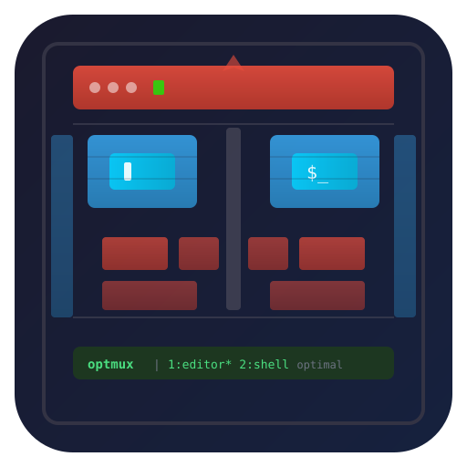

# optmux

<p align="center">
  
</p>

Optimal, opinionated, batteries-included TMUX that's neat and easy for any project.

Run `optmux .` in any project and get its own TMUX, already set up: plugins installed, mouse on everywhere, and one-key shortcuts for the tools you reach for while AI coding agents like Claude Code do the typing. Run several agents side by side, each in its own git worktree and window, and review, correct, and steer them without leaving the keyboard.

**New here?** Read **[The optmux Way](https://github.com/netj/optmux/blob/main/OPTMUX-WAY.md)**: how to stay the master mechanic, not the customer, when working with coding agents.

## What you can do

No prefix needed for the `C-M-` keys: Ctrl+Alt, or Control+Option on a Mac.

| Press | You get |
|---|---|
| `C-M-c` | A new task: a fresh git worktree, a new window, your agent running in it ([wtcode](https://github.com/netj/wtcode)) |
| `C-M-g` | [lazygit](https://github.com/jesseduffield/lazygit) beside the agent, on its uncommitted files or its branch's commits ([review](https://github.com/netj/optmux/blob/main/docs/usage-review.md)) |
| `C-M-d` | The PR diff against the default branch, in delta: scroll with the mouse, click a line number to edit it ([review](https://github.com/netj/optmux/blob/main/docs/usage-review.md)) |
| `C-M-f` | **Find**: files, live grep, tags, and language-server symbols in one picker, opened in your editor at the line ([Find](https://github.com/netj/optmux/blob/main/docs/usage-find.md)) |
| `C-M-x` | **eXtract**: pick a command, path, URL, or hash off the screen and type or copy it ([eXtract](https://github.com/netj/optmux/blob/main/docs/usage-extract.md)) |
| `C-M-s` | A shell in the same workdir |
| `C-M-w` | The branch's PR (or the repo) on GitHub |
| `C-M-z` | Zoom the pane in and out |
| `C-M-h` | The tips screen: every key, plugin, and setting in one place |
| `optmux pick` | Jump to any project you've run optmux in, running or not ([pick](https://github.com/netj/optmux/blob/main/docs/usage-pick.md)) |
| `optmux warp` | A focused session with only one worktree's windows ([warp](https://github.com/netj/optmux/blob/main/docs/usage-warp.md)) |

And out of the box:

- **Every project is isolated**: its own TMUX server, config, plugins, and saved layouts, so nothing leaks between projects.
- **Mouse everywhere**: click panes, drag borders, scroll in TMUX, less, and lazygit.
- **Copy reaches your clipboard, even over SSH** (OSC 52).
- **Your dotfiles stay yours**: optmux's git, delta, and lazygit settings apply only to what its shortcuts start.

## Get started

```bash
brew install netj/tap/optmux
cd myproject
optmux .
```

The formula brings tmux, wtcode, lazygit, delta, a recent `less`, fzf, universal-ctags, and gh along. The first attach installs the plugins and shows the tips; press **`C-M-c`** to start your first task.

No Homebrew? `uvx optmux .` runs it straight from PyPI (bring your own tmux and tools).

## Where to next

**[Using optmux](https://github.com/netj/optmux/blob/main/docs/usage.md)** is the guide to the features above, and the reference for the `optmux` command. optmux compiles the YAML you give it into a generated directory next to it, so there is nothing to maintain by hand.

**[Review changes](https://github.com/netj/optmux/blob/main/docs/usage-review.md)** from many agents with ease: lazygit, the branch diff, and the PR open in the worktree you're in; diffs render in delta, and line numbers and commit hashes are links that open your editor or GitHub.

**[Extract what you see](https://github.com/netj/optmux/blob/main/docs/usage-extract.md)** to repeat or copy it. A command in the agent's output, a path in an error, a URL: pick it from the screen and type it into a pane or copy it to your clipboard, locally or over SSH. It also covers which terminals support copying over SSH.

**[Find and open](https://github.com/netj/optmux/blob/main/docs/usage-find.md)** files, lines, tags, and symbols in your editor, beside the agent, ranked together and remembering where you left off.

**[Pick among many projects](https://github.com/netj/optmux/blob/main/docs/usage-pick.md)** with `optmux pick`, the one command to remember on a host with several optmux projects, and bring sessions back after a restart with tmux-resurrect.

**[Focus on one workdir](https://github.com/netj/optmux/blob/main/docs/usage-warp.md)** with `optmux warp`: a session that links in only the windows of a single worktree, so an IDE or another terminal such as [cmux](https://cmux.com) can share an agent's window.

**[Configure](https://github.com/netj/optmux/blob/main/docs/config.md)** shortcuts, menus, plugins, and tool settings in the YAML under `+optmux:`, for one project or for all of them in `~/.optmux.yaml`:

```yaml
+optmux:
  +shortcuts:
    C-M-b: gh browse .
    C-M-t:
      +send_keys: pytest -x
  +env:
    EDITOR: nvim
```

[`transform.optmux.yaml`](https://github.com/netj/optmux/blob/main/transform.optmux.yaml) shows what optmux's plugins and tools can transform into: delete the `#` in front of the ones you like. A project's YAML is also a [tmuxp](https://tmuxp.git-pull.com/configuration/) config, if you'd rather start every session with the same windows and panes.

**Troubleshooting**: [tmux-fingers](https://github.com/netj/optmux/blob/main/docs/troubleshooting/tmux-fingers.md) and [floating panes](https://github.com/netj/optmux/blob/main/docs/troubleshooting/tmux-floating-panes.md). Hacking on optmux itself? See [developing optmux](https://github.com/netj/optmux/blob/main/docs/development.md).

## License

[MIT](LICENSE)
